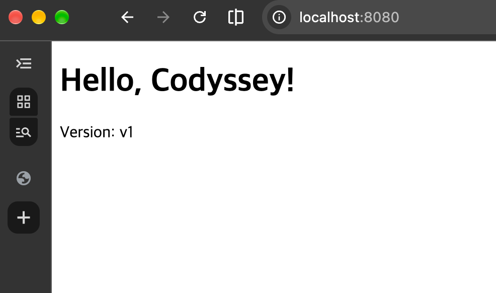
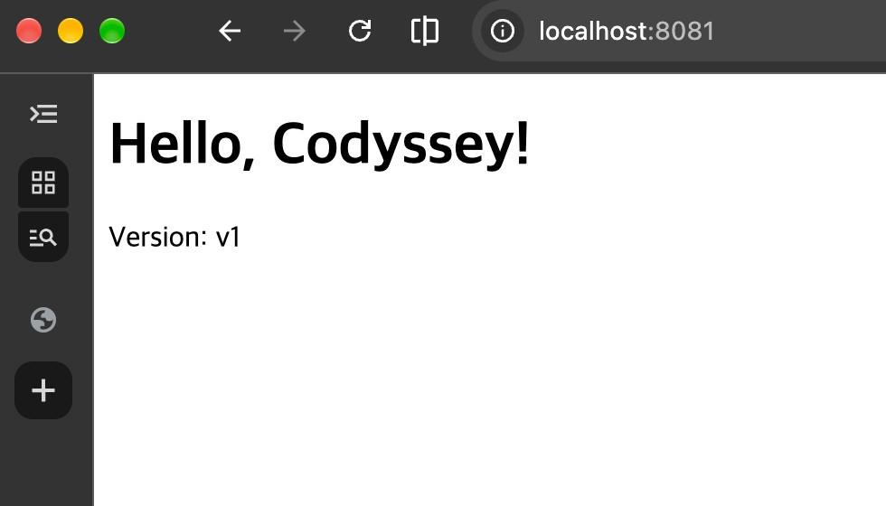
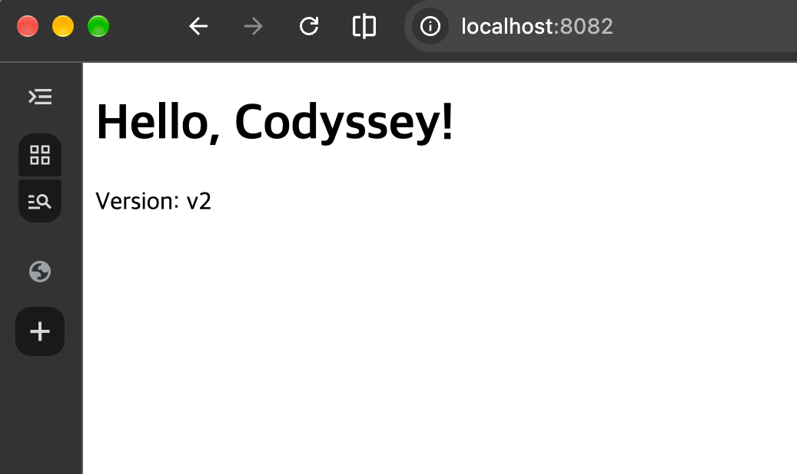
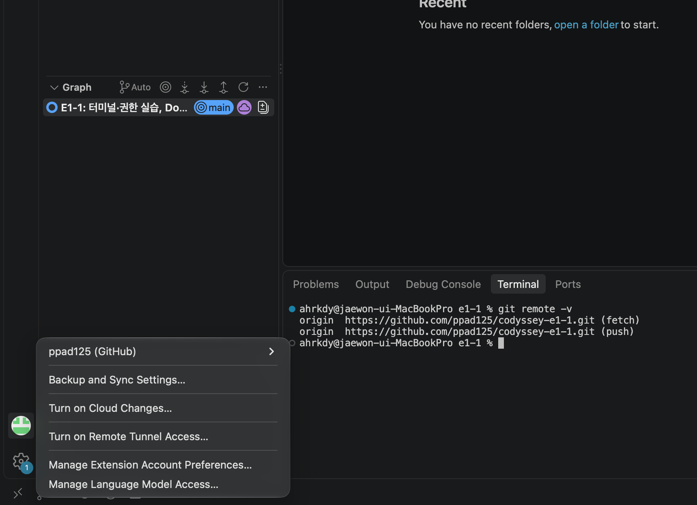

# E1-1. 내 컴퓨터에 개발자용 '작업실' 꾸미기

## 1. 프로젝트 개요
터미널, Docker, Git을 직접 세팅하고 사용해 보며 개발 환경을 구성했습니다.
nginx 기반 커스텀 이미지를 만들어 포트 매핑으로 접속하고,
바인드 마운트와 볼륨으로 "변경 반영"과 "데이터 영속성"을 검증했습니다.

## 2. 실행 환경

| 항목 | 내용 |
|---|---|
| OS | macOS (27.2) |
| Shell | zsh 5.9 (arm64-apple-darwin26.0) |
| Terminal | macOS 터미널 (Terminal.app), VSCode 통합 터미널 |
| Docker | Docker Desktop / Docker version 29.8.2, build 7fc2dff |
| Docker Compose | v5.6.0 |
| Git | 2.54.0 (Apple Git-157) |

## 3. 프로젝트 구조

```text
e1-1/
├── README.md              # 기술 문서 (전체 수행 내용 요약 + 링크)
├── Dockerfile             # 커스텀 웹 서버 이미지 설계도 (nginx:alpine 기반)
├── docker-compose.yml     # 보너스: web + client 멀티 컨테이너 실행 설정
├── .gitignore             # Git에서 제외할 파일 (.DS_Store)
├── app/
│   └── index.html         # 웹 서버 소스 (nginx가 제공하는 정적 페이지)
├── practice/              # 터미널·권한 실습 결과물
│   ├── hello.txt          # echo로 만든 파일
│   ├── empty.txt          # touch로 만든 빈 파일
│   ├── .secret            # 숨김 파일 실습
│   └── run.sh             # 권한 실습용 스크립트 (755)
├── logs/                  # 단계별 명령 + 출력 전체 로그
│   └── 01-terminal.md ~ 10-port-conflict.md
└── docs/
    └── screenshots/       # 브라우저 접속·VSCode 연동 증거 캡처
```

| 구분 | 구성 기준 |
|---|---|
| 루트 | 실행에 바로 필요한 설정 파일(`Dockerfile`, `docker-compose.yml`)과 문서(`README.md`) |
| `app/` | 컨테이너에 들어갈 **웹 서버 소스**만 분리 (`COPY app/`, 바인드 마운트 대상) |
| `practice/` | 터미널·권한 실습 결과물 (실행 코드와 분리) |
| `logs/` | 수행 증거(명령+출력)를 단계별 파일로 분리해 README를 간결하게 유지 |
| `docs/screenshots/` | 이미지 증거를 한곳에 모음 |

## 4. 수행 체크리스트
- [x] 터미널 기본 조작 (위치 확인, 숨김 포함 목록, 이동, 생성, 복사, 이동/이름변경, 삭제, 내용 확인, 빈 파일)
- [x] 권한 변경 실습 (파일 1개, 디렉토리 1개 / 변경 전·후 비교)
- [x] Docker 설치 점검 (`docker --version`, `docker info`)
- [x] Docker 기본 운영 (pull, images, run, ps, ps -a, logs, stats, stop)
- [x] hello-world 실행, ubuntu 컨테이너 진입, attach/exec 차이 관찰
- [x] Dockerfile 커스텀 이미지 빌드·실행 (`my-web:1.0`)
- [x] 포트 매핑 접속 2회 (8080, 8081)
- [x] 바인드 마운트 반영 (8082, v1 → v2)
- [x] Docker 볼륨 영속성 (컨테이너 삭제 전·후)
- [x] Git 설정 (user.name, user.email, init.defaultBranch)
- [x] GitHub 연동 및 push, VSCode GitHub 로그인
- [x] 포트 충돌 진단 및 해결 (`lsof`로 원인 프로세스 확인 → 포트 해제)
- [x] 보너스: Docker Compose (단일, 멀티, up/down/ps/logs, 환경 변수), SSH 키

## 5. 터미널 조작 로그
작업 폴더를 만들고 파일 생성·복사·이동·이름 변경·삭제와 절대/상대 경로 실습을 터미널로 수행했습니다.
`ls`와 `ls -la`를 비교해 숨김 파일(`.secret`)을 확인했습니다.

📄 전체 로그: [logs/01-terminal.md](logs/01-terminal.md)

## 6. 실습 기록

### 6-1. 권한 실습
파일(`run.sh`)은 644 → 755로 바꿔 `permission denied`에서 실행 성공으로,
디렉토리(`secret_dir`)는 600으로 바꿔 `cd`가 거부되는 것을 확인했습니다.

📄 전체 로그: [logs/02-permissions.md](logs/02-permissions.md)

### 6-2. Docker 설치 점검 및 기본 운영
`docker --version`, `docker info`로 설치와 데몬 동작을 확인하고, hello-world·ubuntu 컨테이너 실행,
logs·stats·stop, attach와 exec의 차이를 실습했습니다.

📄 전체 로그: [logs/03-docker-basic.md](logs/03-docker-basic.md)

### 6-3. Dockerfile 커스텀 이미지
`nginx:alpine`을 베이스로 LABEL·ENV·COPY를 적용해 커스텀 이미지 `my-web:1.0`을 빌드했습니다.

📄 전체 로그: [logs/04-dockerfile.md](logs/04-dockerfile.md) · 설정: [Dockerfile](Dockerfile)

### 6-4. 포트 매핑
같은 이미지로 컨테이너 2개를 만들어 `-p 8080:80`, `-p 8081:80`으로 각각 접속했습니다.

| `localhost:8080` | `localhost:8081` |
|---|---|
|  |  |

📄 전체 로그: [logs/05-port-mapping.md](logs/05-port-mapping.md)

### 6-5. 바인드 마운트
맥의 `app/` 폴더를 연결한 8082 컨테이너는 파일 수정(v1 → v2)이 즉시 반영되었고,
이미지에 COPY한 8080은 v1 그대로였습니다.



📄 전체 로그: [logs/06-bind-mount.md](logs/06-bind-mount.md)

### 6-6. Docker 볼륨 영속성
볼륨 `mydata`에 데이터를 저장한 컨테이너를 삭제한 뒤, 새 컨테이너에서도 데이터가 유지되는 것을 확인했습니다.

📄 전체 로그: [logs/07-volume.md](logs/07-volume.md)

### 6-7. Git 설정 및 GitHub 연동
사용자 정보와 기본 브랜치(main)를 설정하고, GitHub에 push한 뒤 VSCode에서 GitHub 계정과
저장소 연동을 확인했습니다.



📄 전체 로그: [logs/08-git.md](logs/08-git.md)

## 7. 보너스: Docker Compose · SSH 키
Compose로 웹 서버와 보조 서비스를 함께 실행해 서비스 이름으로 통신을 확인하고,
환경 변수로 포트(9090)와 모드(prod)를 바꿨습니다. SSH 키를 등록해 SSH 방식으로 push했습니다.

📄 전체 로그: [logs/09-bonus.md](logs/09-bonus.md) · 설정: [docker-compose.yml](docker-compose.yml)

## 8. 트러블슈팅

### 8-1. 따옴표를 닫지 않아 파일이 생성되지 않음 (터미널)

- **문제**: `echo "Hello Codyssey > hello.txt`를 입력하자 프롬프트가 `dquote>`로 바뀌었고, 이후 `ls`로 확인했을 때 `hello.txt`가 생성되지 않았습니다.
- **원인 가설**: 여는 따옴표(`"`)만 있고 닫는 따옴표가 없어서, 셸이 문자열이 끝나지 않은 것으로 보고 다음 입력을 기다리는 것이라고 생각했습니다.
- **확인**: 나중에 `"`를 입력하자 `Hello Codyssey > hello.txt`가 화면에 그대로 출력되었습니다. `>`까지 문자열로 처리되어 파일로 저장되지 않았다는 것을 확인했습니다.
- **해결**: `Ctrl + C`로 입력을 취소한 뒤, 따옴표 없이 `echo Hello Codyssey > hello.txt`로 다시 실행했습니다. `ls -la`에서 크기 15의 `hello.txt`가 생성된 것을 확인했습니다.
- **배운 점**: `dquote>`가 보이면 입력이 끝나지 않았다는 신호입니다. 한글 입력 상태에서는 따옴표가 다른 문자로 입력될 수 있어, 영문 입력 상태에서 입력하는 것이 안전합니다.

📄 관련 로그: [logs/01-terminal.md](logs/01-terminal.md)

### 8-2. 컨테이너 이름 중복 오류 (Docker)

- **문제**: `docker run -d -p 8081:80 --name web-8080 my-web:1.0` 실행 시 아래 오류가 발생했습니다.
  ```text
  docker: Error response from daemon: Conflict. The container name "/web-8080" is already in use by container "a731f96a2a1e..."
  ```
- **원인 가설**: 포트는 8081로 바꿨지만, 컨테이너 이름 `web-8080`을 이미 다른 컨테이너가 사용하고 있어서라고 생각했습니다.
- **확인**: `docker ps`로 확인하자 `web-8080`이라는 이름의 컨테이너가 8080 포트로 실행 중이었습니다.
- **해결**: 이름을 `web-8081`로 바꿔 `docker run -d -p 8081:80 --name web-8081 my-web:1.0`으로 실행했습니다. (기존 컨테이너를 `docker rm`으로 삭제하는 방법도 있습니다.)
- **배운 점**: 컨테이너 이름은 중복될 수 없고, 이름과 포트는 서로 관계가 없습니다. 실제 포트 연결은 `-p` 옵션만 결정합니다.

📄 관련 로그: [logs/05-port-mapping.md](logs/05-port-mapping.md)

### 8-3. GitHub 이메일 비공개 설정과 커밋 이메일 (Git · 보안)

- **문제**: Git의 `user.email`이 개인 이메일로 설정된 상태에서 커밋하고 push하면, 공개 저장소의 커밋 기록에 개인 이메일이 노출될 수 있었습니다.
- **원인 가설**: GitHub에 이메일 비공개 설정이 켜져 있다면, 개인 이메일이 들어간 커밋의 push가 차단될 것이라고 생각했습니다.
- **확인**: GitHub Settings → Emails에서 "Keep my email addresses private"와 "Block command line pushes that expose my email"이 모두 켜져 있는 것을 확인했습니다. 이 상태로 push하면 `GH007` 오류로 거부됩니다.
- **해결**: 첫 커밋 전에 `git config --global user.email`을 GitHub가 제공하는 noreply 주소(`숫자+아이디@users.noreply.github.com`)로 변경했습니다. 이후 push가 정상적으로 완료되었습니다.
- **배운 점**: 공개 저장소에는 커밋 작성자 정보도 함께 공개됩니다. 개인정보 보호를 위해 noreply 이메일을 사용하는 것이 좋습니다.

📄 관련 로그: [logs/08-git.md](logs/08-git.md)

### 8-4. 포트 충돌 진단 및 해결 (Docker · 네트워크)

- **문제**: `docker run -d -p 8090:80 --name web-conflict my-web:1.0` 실행 시 아래 오류가 발생했습니다.
  ```text
  docker: Error response from daemon: ports are not available: exposing port TCP 0.0.0.0:8090 -> 127.0.0.1:0: listen tcp 0.0.0.0:8090: bind: address already in use
  ```
- **원인 가설**: 호스트의 8090 포트를 다른 프로세스나 컨테이너가 이미 사용하고 있다고 생각했습니다.
- **확인**:
  ```console
  $ lsof -nP -iTCP:8090 -sTCP:LISTEN
  COMMAND   PID   USER   FD   TYPE            DEVICE SIZE/OFF NODE NAME
  Python  51466 ahrkdy    5u  IPv6 0xadfbe06a1fdf133      0t0  TCP *:8090 (LISTEN)
  $ docker ps --filter publish=8090
  CONTAINER ID   IMAGE     COMMAND   CREATED   STATUS    PORTS     NAMES
  ```
  컨테이너가 아니라 Python 프로세스(PID 51466)가 8090을 점유하고 있었습니다.
- **해결**: `kill 51466`으로 포트를 해제하고 `lsof` 출력이 비어 있는 것을 확인했습니다. 시작에 실패한 채 남은 컨테이너를 `docker rm`으로 지운 뒤 다시 실행하자 `curl http://localhost:8090`이 정상 응답했습니다.
- **대안**: 포트를 쓰는 프로세스를 종료하면 안 되는 경우에는 `-p 8091:80`처럼 호스트 포트만 바꿔 실행합니다.

📄 관련 로그 (진단 절차 전체): [logs/10-port-conflict.md](logs/10-port-conflict.md)

## 9. 개념 정리 (과제 목표)

### 9-1. 절대 경로 vs 상대 경로

- **절대 경로**는 루트(`/`)나 홈(`~`)부터 시작하는 전체 주소로, 현재 위치와 상관없이 항상 같은 파일을 가리킵니다.
  - 예: `cat ~/Codyssey/e1-1/practice/docs/renamed.txt`
- **상대 경로**는 현재 위치(`pwd`)를 기준으로 한 주소로, 현재 위치가 바뀌면 가리키는 대상도 바뀝니다. `.`은 현재 폴더, `..`은 상위 폴더입니다.
  - 예: `docs` 폴더 안에서 `cat renamed.txt`, `cat ../hello.txt`
- `..`은 "뒤로 가기"가 아니라 항상 **상위(부모) 폴더**를 뜻합니다. 직전 위치로 돌아가는 것은 `cd -`입니다.

### 9-2. 파일 권한 (r/w/x, 755, 644)

- 권한 문자열 `-rwxr-xr-x`는 **[종류 1자리] + [소유자 3] + [그룹 3] + [기타 사용자 3]**으로 읽습니다.
- 숫자 표기는 **r=4, w=2, x=1**을 더한 값을 소유자·그룹·기타 순서로 쓴 것입니다.
  - `755` = `rwx`(7) / `r-x`(5) / `r-x`(5): 소유자만 수정 가능, 모두 읽기·실행 가능 (실행 파일, 폴더)
  - `644` = `rw-`(6) / `r--`(4) / `r--`(4): 소유자만 수정 가능, 모두 읽기만 가능 (일반 파일)
- 파일에서 `x`는 **실행**, 폴더에서 `x`는 **안으로 들어가기(`cd`)** 권한입니다.
- macOS는 umask가 `022`라서 새 파일은 `644`, 새 폴더는 `755`로 생성됩니다. 그래서 새로 만든 스크립트는 `chmod 755`로 실행 권한을 줘야 실행할 수 있었습니다.

### 9-3. 기존 Dockerfile 기반 커스텀 이미지

- 공식 이미지 `nginx:alpine`을 `FROM`으로 가져오고, 그 위에 `LABEL`(정보), `ENV`(환경 변수), `COPY`(내 웹페이지)를 더해 Dockerfile을 작성했습니다.
- `docker build -t my-web:1.0 .`으로 빌드하면 Dockerfile의 각 명령이 단계별로 실행되어 새 이미지가 만들어집니다.
- **이미지**는 설계도(붕어빵 틀), **컨테이너**는 그 이미지로 만든 실행 중인 실체(붕어빵)입니다. 하나의 이미지로 여러 컨테이너를 만들 수 있습니다.

### 9-4. 포트 매핑이 필요한 이유

- 컨테이너는 격리된 네트워크 안에서 실행되기 때문에, 컨테이너 안의 80번 포트에 맥에서 바로 접속할 수 없습니다.
- `-p 호스트포트:컨테이너포트`(예: `-p 8080:80`)로 맥의 포트를 컨테이너 포트에 연결해야 브라우저에서 `localhost:8080`으로 접속할 수 있습니다.
- 같은 이미지로 컨테이너 2개를 만들어도, 각각 격리되어 있어 안쪽 포트(80)는 같아도 충돌하지 않습니다. 바깥 포트만 다르게(8080, 8081) 연결하면 됩니다.

### 9-5. Docker 볼륨 (영속 데이터)

- 컨테이너 안에 저장한 데이터는 컨테이너를 삭제하면 함께 사라집니다.
- **볼륨**은 Docker가 관리하는 별도 저장 공간으로, 컨테이너와 수명이 분리되어 컨테이너를 삭제해도 데이터가 남습니다. (비유: 사무실(컨테이너)을 빼도 남아 있는 개인 사물함(볼륨))
- **바인드 마운트**는 맥의 특정 폴더를 그대로 연결하는 방식으로, 개발 중 파일 변경을 즉시 반영할 때 유용합니다. `-v` 왼쪽이 경로면 바인드 마운트, 이름이면 볼륨입니다.

### 9-6. Git vs GitHub

- **Git**은 내 컴퓨터에서 동작하는 버전 관리 도구입니다. 기록은 작업 폴더 안의 `.git` 폴더에 저장되며, `add`·`commit`·`log`는 인터넷 없이도 동작합니다.
- **GitHub**는 Git 저장소를 인터넷에 올려 공유하고 협업하는 원격 플랫폼입니다. `push`(올리기)와 `pull`·`clone`(받기)을 할 때만 네트워크가 필요합니다.
- 작업 흐름은 **`add`(스테이징) → `commit`(로컬 기록) → `push`(GitHub로 업로드)**입니다.

## 10. 재현 방법

```bash
# 1. 저장소 받기
git clone https://github.com/ppad125/codyssey-e1-1.git
cd codyssey-e1-1

# 2. 커스텀 이미지 빌드 + 포트 매핑
docker build -t my-web:1.0 .
docker run -d -p 8080:80 --name web-8080 my-web:1.0
curl http://localhost:8080

# 3. 바인드 마운트 (app/index.html 수정 후 새로고침하면 바로 반영)
docker run -d -p 8082:80 --name web-bind -v "$(pwd)/app:/usr/share/nginx/html" nginx:alpine
curl http://localhost:8082

# 4. 볼륨 영속성
docker volume create mydata
docker run -d --name vol-test -v mydata:/data ubuntu:24.04 sleep infinity
docker exec vol-test bash -c "echo hello-volume > /data/hello.txt"
docker rm -f vol-test
docker run --rm -v mydata:/data ubuntu:24.04 cat /data/hello.txt   # → hello-volume

# 5. 보너스: Docker Compose
WEB_PORT=9090 APP_ENV=prod docker compose up -d
docker compose logs client
docker compose down

# 정리
docker rm -f web-8080 web-bind
docker volume rm mydata
```

**주의사항**
- 8080, 8082, 9090 포트가 이미 사용 중이면 `lsof -nP -iTCP:<포트> -sTCP:LISTEN`으로 사용 중인 프로세스를 확인하고, 종료하거나 `-p 9080:80`처럼 호스트 포트만 바꿔 실행합니다. ([8-4. 포트 충돌 진단](#8-4-포트-충돌-진단-및-해결-docker--네트워크) 참고)
- sudo 권한이 제한된 환경(예: 서울캠퍼스)에서는 Docker Desktop 대신 OrbStack을 실행하면 같은 명령을 사용할 수 있습니다.
