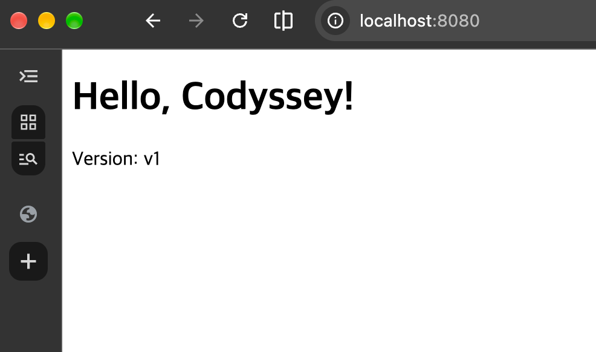
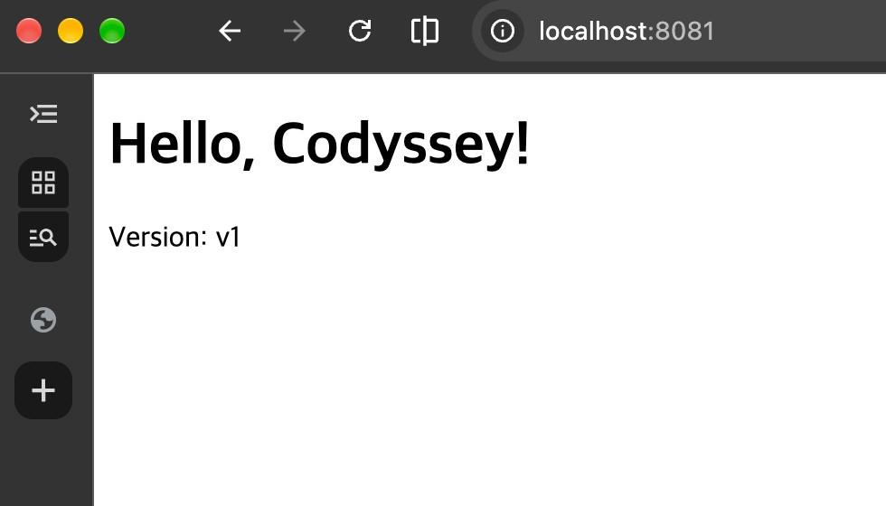

# 05. 포트 매핑

[← README로 돌아가기](../README.md)

같은 이미지 `my-web:1.0`으로 컨테이너 2개를 만들어, 호스트 포트 8080과 8081로 각각 접속했습니다.

## 1. 컨테이너 실행

```console
$ docker run -d -p 8080:80 --name web-8080 my-web:1.0
a731f96a2a1ecf65f89648e5b2311ccf6e29430b9cfe1d991bb89b299243eb4f
$ docker run -d -p 8081:80 --name web-8081 my-web:1.0
77acd168f7d9164692a31a3671f99d35c77074b1bb9cfec6ee06e5a159057ff7
$ docker ps
CONTAINER ID   IMAGE        COMMAND                   CREATED          STATUS          PORTS                                     NAMES
77acd168f7d9   my-web:1.0   "/docker-entrypoint.…"   2 seconds ago    Up 2 seconds    0.0.0.0:8081->80/tcp, [::]:8081->80/tcp   web-8081
a731f96a2a1e   my-web:1.0   "/docker-entrypoint.…"   59 seconds ago   Up 58 seconds   0.0.0.0:8080->80/tcp, [::]:8080->80/tcp   web-8080
```

- `-p 호스트포트:컨테이너포트` 형식으로, 맥의 8080·8081을 각 컨테이너의 80번(nginx)에 연결했습니다.

## 2. 접속 확인 (curl)

```console
$ curl http://localhost:8080
<!doctype html>
<html lang="ko">
<head>
  <meta charset="utf-8">
  <title>My E1-1 Web</title>
</head>
<body>
  <h1>Hello, Codyssey!</h1>
  <p>Version: v1</p>
</body>
</html>

$ curl http://localhost:8081
<!doctype html>
<html lang="ko">
<head>
  <meta charset="utf-8">
  <title>My E1-1 Web</title>
</head>
<body>
  <h1>Hello, Codyssey!</h1>
  <p>Version: v1</p>
</body>
</html>
```

## 3. 브라우저 접속 (주소창 포트 포함)

| `localhost:8080` | `localhost:8081` |
|---|---|
|  |  |

## 실수와 수정 기록

### 컨테이너 이름 중복 (Conflict)

```console
$ docker run -d -p 8080:80 --name web-8080 my-web:1.0
docker: Error response from daemon: Conflict. The container name "/web-8080" is already in use by container "a731f96a2a1ecf65f89648e5b2311ccf6e29430b9cfe1d991bb89b299243eb4f". You have to remove (or rename) that container to be able to reuse that name.

$ docker run -d -p 8081:80 --name web-8080 my-web:1.0
docker: Error response from daemon: Conflict. The container name "/web-8080" is already in use by container "a731f96a2a1ecf65f89648e5b2311ccf6e29430b9cfe1d991bb89b299243eb4f". You have to remove (or rename) that container to be able to reuse that name.
```

- 포트를 8081로 바꿔도 이름이 `web-8080`으로 중복되어 실패했습니다.
- 컨테이너 이름은 중복될 수 없어서, 이름을 `web-8081`로 바꿔 실행해 해결했습니다.
- 이름과 포트는 서로 관계가 없고, 실제 연결은 `-p` 옵션만 결정합니다.
