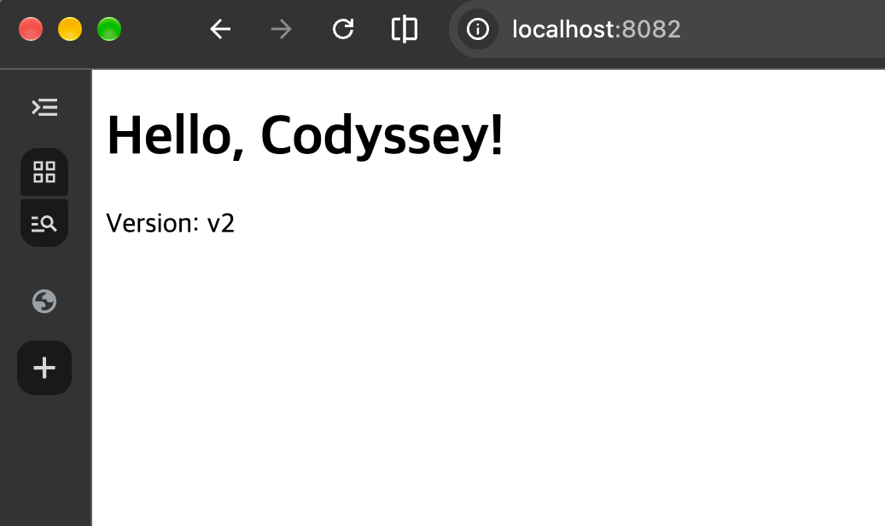

# 06. 바인드 마운트

[← README로 돌아가기](../README.md)

맥의 `app/` 폴더를 컨테이너에 바인드 마운트하고, 호스트에서 파일을 수정했을 때 컨테이너에 바로 반영되는지 확인했습니다.

## 1. 바인드 마운트로 실행 + 변경 전 확인

```console
$ docker run -d -p 8082:80 --name web-bind -v "$(pwd)/app:/usr/share/nginx/html" nginx:alpine
Unable to find image 'nginx:alpine' locally
alpine: Pulling from library/nginx
Digest: sha256:785835ea65db4bba6f021acc0f3be91b0fef76a53fe41f8588c6698d2aed0606
Status: Downloaded newer image for nginx:alpine
bdf0e47c66f3038ece1c7d4eb960416e5c76831c0bb241efcac546ddd263fe11

$ curl http://localhost:8082             # 변경 전
<!doctype html>
<html lang="ko">
<head>
  <meta charset="utf-8">
  <title>My E1-1 Web</title>
</head>
<body>
  <h1>Hello, Codyssey!</h1>
  <p>Version: v1</p>
</body>
</html>
```

- `-v 호스트경로:컨테이너경로`로 맥의 `app/`을 nginx의 웹 폴더에 연결했습니다.
- 바인드 마운트는 절대 경로가 필요해 `$(pwd)`로 현재 위치를 넣었습니다.

## 2. 호스트에서 파일 수정 후 비교

```console
$ nano app/index.html                    # Version: v1 → v2 로 수정

$ curl http://localhost:8082             # 바인드 마운트: 변경 후
<!doctype html>
<html lang="ko">
<head>
  <meta charset="utf-8">
  <title>My E1-1 Web</title>
</head>
<body>
  <h1>Hello, Codyssey!</h1>
  <p>Version: v2</p>
</body>
</html>

$ curl http://localhost:8080             # 비교: 이미지에 COPY된 컨테이너
<!doctype html>
<html lang="ko">
<head>
  <meta charset="utf-8">
  <title>My E1-1 Web</title>
</head>
<body>
  <h1>Hello, Codyssey!</h1>
  <p>Version: v1</p>
</body>
</html>
```

| 포트 | 방식 | 수정 전 | 수정 후 |
|---|---|---|---|
| 8082 | 바인드 마운트 | v1 | **v2** (재빌드·재시작 없이 즉시 반영) |
| 8080 | 이미지에 COPY | v1 | v1 (복사본이라 변화 없음) |

## 3. 브라우저 확인 (변경 후)


