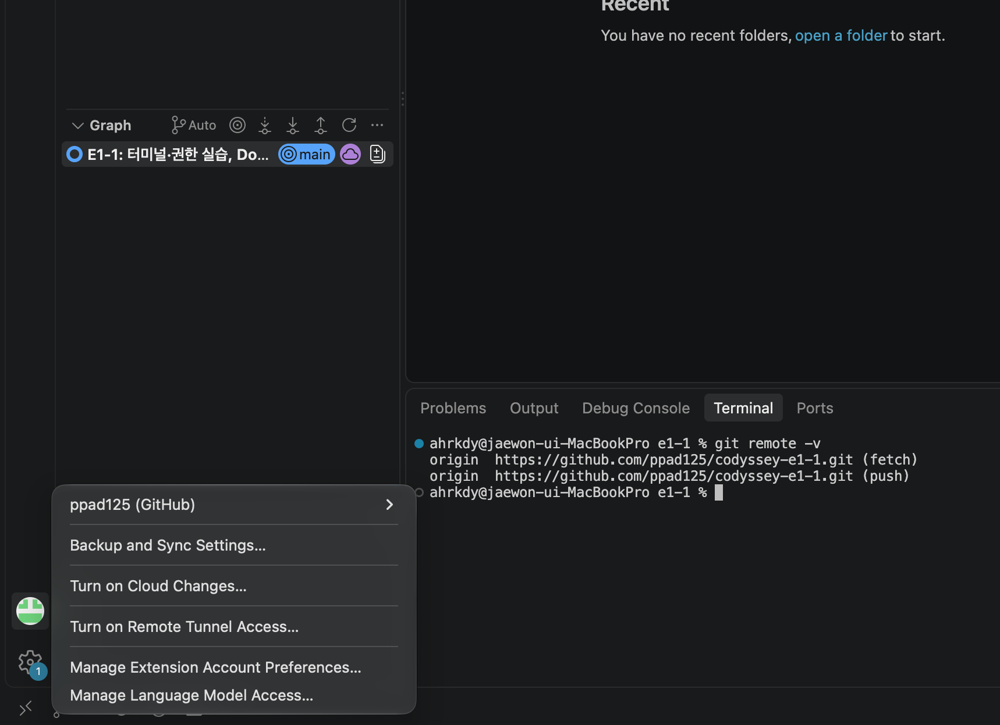

# 08. Git 설정 및 GitHub 연동

[← README로 돌아가기](../README.md)

Git 사용자 정보와 기본 브랜치를 설정하고, 로컬 저장소를 만들어 GitHub에 push한 뒤 VSCode와 연동했습니다.

## 1. Git 설정

```console
$ git --version
git version 2.54.0 (Apple Git-157)
$ git config --global user.name "박재원"
$ git config --global user.email "245995574+ppad125@users.noreply.github.com"
$ git config --global init.defaultBranch main
$ git config --list
credential.helper=osxkeychain
init.defaultbranch=main
user.name=박재원
user.email=245995574+ppad125@users.noreply.github.com
init.defaultbranch=main
```

- GitHub의 이메일 비공개 설정에 맞춰 개인 이메일 대신 GitHub noreply 주소를 사용했습니다.
- `init.defaultbranch`가 두 번 보이는 것은 시스템(Xcode) 설정과 내 전역 설정(`~/.gitconfig`)이 함께 출력되기 때문입니다.

## 2. 로컬 저장소 생성 및 첫 커밋

```console
$ git init
Initialized empty Git repository in /Users/ahrkdy/Codyssey/e1-1/.git/
$ git status
On branch main

No commits yet

Untracked files:
  (use "git add <file>..." to include in what will be committed)
	Dockerfile
	app/
	practice/

nothing added to commit but untracked files present (use "git add" to track)

$ echo ".DS_Store" > .gitignore          # 맥 시스템 파일 제외
$ git add .
$ git status
On branch main

No commits yet

Changes to be committed:
  (use "git rm --cached <file>..." to unstage)
	new file:   .gitignore
	new file:   Dockerfile
	new file:   app/index.html
	new file:   practice/.secret
	new file:   practice/empty.txt
	new file:   practice/hello.txt
	new file:   practice/run.sh

$ git commit -m "E1-1: 터미널·권한 실습, Dockerfile 웹서버 추가"
[main (root-commit) 34a4cdb] E1-1: 터미널·권한 실습, Dockerfile 웹서버 추가
 7 files changed, 28 insertions(+)
 create mode 100644 .gitignore
 create mode 100644 Dockerfile
 create mode 100644 app/index.html
 create mode 100644 practice/.secret
 create mode 100644 practice/empty.txt
 create mode 100644 practice/hello.txt
 create mode 100755 practice/run.sh
$ git log --oneline
34a4cdb (HEAD -> main) E1-1: 터미널·권한 실습, Dockerfile 웹서버 추가
```

- `practice/run.sh`가 `100755`로 기록되어, Git이 실행 권한(755)까지 저장하는 것을 확인했습니다.

## 3. GitHub 원격 저장소 연결 및 push

```console
$ git remote rename orifin origin        # 오타로 등록한 별명 수정 (아래 기록 참고)
$ git remote -v
origin	https://github.com/ppad125/codyssey-e1-1.git (fetch)
origin	https://github.com/ppad125/codyssey-e1-1.git (push)
$ git push -u origin main
Enumerating objects: 10, done.
Counting objects: 100% (10/10), done.
Delta compression using up to 10 threads
Compressing objects: 100% (5/5), done.
Writing objects: 100% (10/10), 1.08 KiB | 1.08 MiB/s, done.
Total 10 (delta 0), reused 0 (delta 0), pack-reused 0 (from 0)
To https://github.com/ppad125/codyssey-e1-1.git
 * [new branch]      main -> main
branch 'main' set up to track 'origin/main'.
```

## 4. VSCode GitHub 연동

VSCode에서 GitHub 계정(`ppad125`)으로 로그인하고, 이 폴더를 열어 원격 저장소 연결과 `main` 브랜치를 확인했습니다.



## 실수와 수정 기록

### 원격 저장소 별명 오타 (orifin)

```console
$ git remote add orifin https://github.com/ppad125/codyssey-e1-1.git
$ git remote -v
orifin	https://github.com/ppad125/codyssey-e1-1.git (fetch)
orifin	https://github.com/ppad125/codyssey-e1-1.git (push)
$ git push -u origin main
fatal: 'origin' does not appear to be a git repository
fatal: Could not read from remote repository.

Please make sure you have the correct access rights
and the repository exists.
```

- 별명을 `origin`이 아닌 `orifin`으로 등록해, `origin`을 찾지 못하는 오류가 났습니다.
- `git remote rename orifin origin`으로 이름을 바꾼 뒤 push에 성공했습니다.

### GitHub 이메일 비공개 설정과 커밋 이메일

- GitHub 설정에서 "Keep my email addresses private"와 "Block command line pushes that expose my email"이 켜져 있었습니다.
- 개인 이메일로 커밋하면 push가 차단되므로, 커밋 전에 `user.email`을 GitHub noreply 주소로 변경했습니다.
